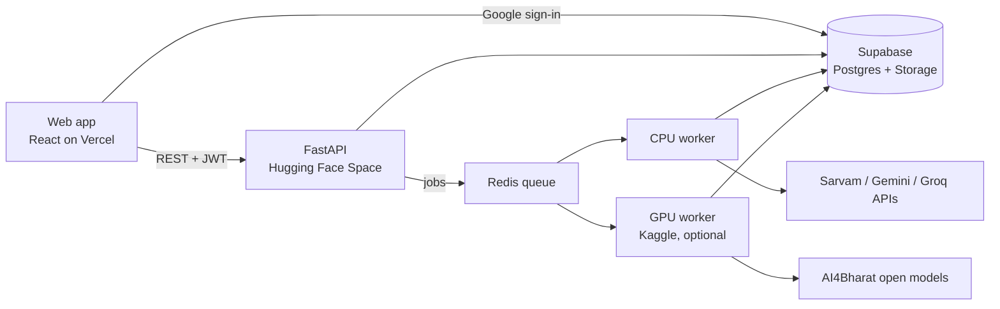
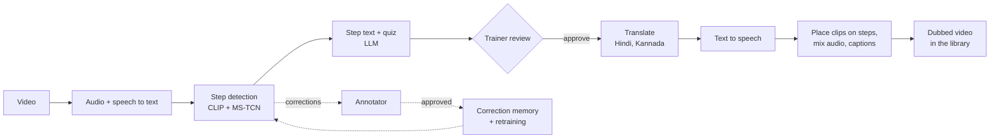
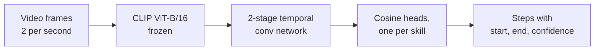
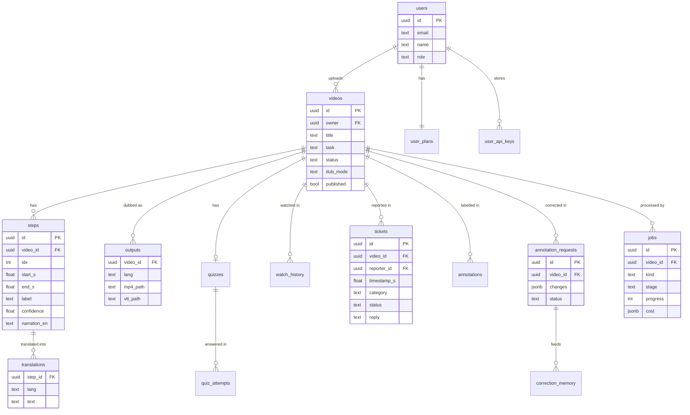

# KaushalDub

Skill videos in the language people work in.

## The problem

Short how-to videos are a common way to teach vocational skills such as CPR, phone repair, car care or cooking.
Most of them are narrated in English, so many learners who work in Hindi or Kannada cannot follow them, and
re-recording every video in every language is slow and expensive.

## Our solution

KaushalDub takes a how-to video and automatically:

1. **finds the steps** with a trained vision model (CLIP + temporal convolutional network),
2. **writes a short instruction** for each step from what the instructor says (LLM),
3. **dubs it into Hindi and Kannada** with captions, timed to each step,
4. **makes a quiz** for learners.

A trainer reviews and publishes the result, learners watch it in their language and can report mistakes, and
annotators correct the model, which learns from every approved correction.

## Tech stack

| Part | Tools |
|---|---|
| Frontend | React, Vite, TypeScript, Tailwind CSS, shadcn/ui |
| Backend | FastAPI (Python), Redis + RQ job queue |
| Database, login, files | Supabase (Postgres, Google sign-in, Storage) |
| Step model | CLIP ViT-B/16 + MS-TCN (PyTorch), trained on COIN |
| Speech, translation, voice | Sarvam AI, or open AI4Bharat models (IndicTrans2, Indic Parler-TTS), Whisper |
| Step text and quiz | Gemini, Groq (fallback) |
| Hosting | Vercel (frontend), Hugging Face Spaces (backend), Kaggle GPU (optional worker) |

## Get the code

```bash
git clone https://github.com/<your-username>/kaushaldub.git
cd kaushaldub
```

```bash
cd backend && python -m venv .venv && .venv/Scripts/pip install -r requirements-dev.txt
```

```bash
cd frontend && npm install
```

Copy `.env.example` to `.env`, add your keys, then run `backend/scripts/dev.py` and `npm run dev` in `frontend/`.
Full setup, Supabase and deployment steps: [docs/SETUP.md](docs/SETUP.md).

## Folder structure

```
kaushaldub/
├── frontend/          React app (trainer, learner and annotator screens)
├── backend/
│   ├── app/           FastAPI routes, job worker, plans, providers
│   ├── scripts/       dev server, batch processing, setup check, migration
│   └── tests/         automated tests (pytest)
├── ml/                dubbing pipeline (kd_pipeline.py) and step model (kd_model.py)
├── supabase/          SQL migrations: tables, security rules, storage
├── notebooks/         training, pipeline check, GPU worker
├── demo/              playlist of test videos and live-demo script
├── docs/              setup guide, paper, images
└── design/            original UI mockup
```

## System design



## How a video is processed



Each stage has a fallback (for example Sarvam → open model, Gemini → Groq → template). If every provider runs out
of credits, the job pauses and the trainer can resume it later.

## Step model



Compared with ResNet-50 + BiLSTM, X-CLIP and CLIP zero-shot on COIN, it gives 42.3 macro-F1 with only 1 M
trainable parameters and the best calibration. Details are in the [paper](docs/paper/kaushaldub_ieee.tex).

## Database design

<!-- Supabase screenshot: save it as docs/images/database.png and remove these comment marks

-->



Also: `user_plans` (free trial counter, model choice), `user_api_keys` (encrypted keys), `quizzes`,
`quiz_attempts`, `watch_history`, `annotations`, `correction_memory`, `model_versions`. Every table has row-level
security.

## API design

All routes need a Supabase login token (`Authorization: Bearer <token>`).

| Method | Route | What it does |
|---|---|---|
| POST | `/videos` | Upload a video (file or YouTube link) and start processing |
| GET | `/videos` | My uploaded videos |
| GET | `/videos/{id}` | Video with steps, quiz and dubbed files |
| PATCH | `/videos/{id}/steps` | Edit step text |
| POST | `/videos/{id}/approve` | Create the dub (step narration or full speech) |
| POST | `/videos/{id}/publish` | Add to the learner library |
| GET | `/jobs/{id}` | Progress of a job, stage by stage |
| GET | `/library` | Search published videos |
| POST | `/quiz/{video_id}/attempts` | Submit quiz answers |
| POST | `/videos/{id}/tickets` | Learner reports a problem at a timestamp |
| GET / PATCH | `/tickets/{id}` | Trainer fixes, replies and closes a report |
| GET / PUT | `/annotations/{clip_id}` | Annotator loads and saves step labels |
| POST | `/annotation-requests/{id}/approve` | Trainer approves selected corrections |
| GET / POST | `/model/status`, `/model/retrain` | Model learning status and retraining |
| GET / PUT | `/me/plan`, `/me/keys/{provider}` | Plan, model choice and own API keys |

The full, interactive list is at `/docs` on the running backend.

## Results so far

- 30 COIN test videos dubbed into Hindi and Kannada across four domains
- About **Rs. 4 and 4–5 minutes per video** with Sarvam, or free with open models on a GPU
- 47 automated tests pass

## What could be improved

- A listening test with real learners to rate voice quality
- More skills, by collecting corrections from annotators
- Removing the original voice cleanly in full-speech mode (voice separation)
- Running the step model on a GPU in production to cut processing time

---

RV University, CS3235 (Module 3: Multimodal AI) coursework. COIN annotations are CC BY-NC 4.0.
