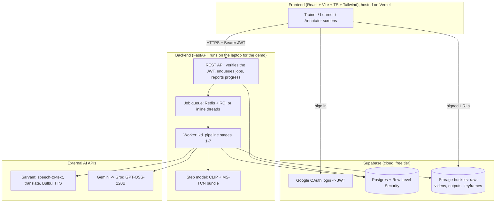
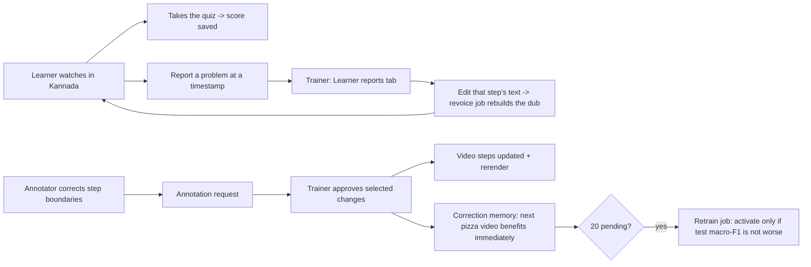

# 4. System architecture and the full flow of one video

This doc follows **one example video** through the whole system.

**Example:** `demo/live/1_pizza_deep_dish.mp4`
- 113 s long
- English speech
- skill **MakePizza**
- targets **Hindi + Kannada**
- uploaded by a Trainer

---

## 4.1 The architecture at a glance



| Layer | Technology | Why |
|---|---|---|
| Frontend | React 18, Vite, TypeScript, Tailwind, React Query, native `<video>` with `<track>` VTT | fast, typed, polls job progress |
| Auth | Supabase Google OAuth | one-click login; the JWT carries the user id |
| Database | Supabase Postgres with **Row Level Security** (17 tables) | each user sees only their own rows; learners see published videos |
| File storage | Supabase Storage: `raw-videos`, `outputs` (mp4/vtt/wav), `keyframes` | private buckets with **signed URLs** that expire |
| API | FastAPI (Python) | async, auto-docs at `/docs`, easy to wrap ML code |
| Jobs | RQ on Redis (inline threads in dev) | long work never blocks the API |
| Worker | the same Python code on a CPU laptop, or a Kaggle GPU notebook (`notebooks/worker_gpu.ipynb`) | the GPU is only needed for the free AI4Bharat models |
| Secrets | `.env`; user API keys **Fernet-encrypted** in the database | keys never reach the browser and never appear in logs |

---

## 4.2 Step 0: upload

1. The trainer signs in with Google, and Supabase returns a **JWT**.
2. On **My videos** they drop the mp4 (or paste a YouTube URL) and fill in:
   - title: "Deep dish pizza"
   - skill: **Make pizza**
   - spoken language: **Detect automatically**
   - targets: **Hindi, Kannada**
   - voice: Male
   - quiz: on
   - narration style: **Step narration** (or **Full speech translation**, see §4.11)
3. The browser sends `POST /videos` (multipart) with `Authorization: Bearer <JWT>`.
4. FastAPI then:
   - **verifies the JWT** with the Supabase signing key;
   - checks the **plan**: free trial (5 videos), your own keys (BYOK), or local models;
   - uploads the file to the `raw-videos` bucket;
   - inserts rows into `videos` (status `queued`) and `jobs` (kind `process`);
   - **enqueues** the job and returns `{video_id, job_id}` immediately.
5. The frontend goes to the **Processing** page and polls `GET /jobs/{id}` every couple of seconds. The page shows the stage list and a progress bar.

---

## 4.3 Stage 1: fetch, and separate audio from video (ffmpeg)

The worker downloads the video into a temp folder (or uses `yt-dlp` for a YouTube link).

**ffmpeg splits the one file into the two signals we need:**

| Signal | ffmpeg command (simplified) | Result | Used by |
|---|---|---|---|
| **Audio** | `ffmpeg -i in.mp4 -vn -ac 1 -ar 16000 audio.wav` | 16 kHz **mono** WAV | speech-to-text |
| **Frames** | `ffmpeg -i in.mp4 -vf fps=2,scale=224:224:...increase,crop=224:224 -f rawvideo -pix_fmt rgb24 -` | 226 frames of 224×224 RGB for 113 s | step model |
| Thumbnail | one frame at 2 s | `thumb.jpg` | library card |

- `-vn` means "no video". 16 kHz mono is the standard input for speech recognition.
- If the video has **no audio track** (music-only or silent), the system logs a warning and continues. Steps then come from the vision model alone. **This is the main advantage of a vision-first design.**

## 4.4 Stage 2: speech to text (ASR)

**Provider chain:** Sarvam (default) → Whisper / IndicConformer (local).

1. The audio is cut into chunks of **25 s or less** (`chunk_audio`, which cuts at quiet points so words are not split).
2. Each chunk is sent to the **Sarvam Speech-to-Text API** with `language_code="unknown"` (auto-detect) and `with_timestamps=true`.
3. Sarvam returns words with start and end times, plus the detected language code. The most common detected code becomes the video's spoken language, `en` here.
4. Result: a **timed transcript**, `[{start, end, text}, ...]`.

Errors are handled per provider:
- **HTTP 429** (rate limit) → retry with back-off.
- **HTTP 402** (out of credits) → no retry; move to the next provider. If none is left, the job pauses with status `needs_credits` and a clear message.

## 4.5 Stage 3: step detection (computer vision)

This stage is explained fully in [03_CV_MODEL.md](03_CV_MODEL.md).

1. The 226 frames go through **frozen CLIP ViT-B/16**, giving a 226×512 feature matrix.
2. The **correction memory** for MakePizza (if any annotator corrections exist) is blended into the class vectors.
3. The **MS-TCN** produces per-frame logits, then softmax with the skill's temperature gives 226×5 probabilities (background plus 4 pizza steps).
4. Decoding: argmax → smooth blips under 2 s → merge → `merge_steps`. The result:

```
1  12.0–31.5 s  knead the dough     conf 0.81
2  33.0–58.0 s  unroll the dough    conf 0.74
3  61.0–92.5 s  add seasoning       conf 0.55   <- LOW CONFIDENCE
```

5. Each low-confidence step gets a **keyframe JPG** from its middle, stored in the `keyframes` bucket and shown to the LLM and the trainer.
6. The features are saved, so annotator corrections can later be turned into correction memory.

## 4.6 Stage 4: the LLM writes step text and a quiz

**Provider chain:** Gemini (newest Flash, auto-picked) → a second Gemini model if the first is overloaded (503) → **Groq GPT-OSS-120B** → a template.

1. `build_prompt` sends, for each step:
   - its time span, label and confidence;
   - the **transcript words inside that span**;
   - a **word budget of about 2 words per second** of the step, so the narration fits the time;
   - keyframes for the low-confidence steps.
2. The rules in the prompt: return **JSON**, exactly **one entry per step in the same order**, and **do not add facts** that are not in the speech or the label.
3. The output for each step is a **title**, an **instruction** and a **narration** (English), plus a **3-question multiple-choice quiz**.
4. `validate_llm` checks the step count, the order and the fields. If the check fails, the system retries once. If it still fails, `template_steps` builds the text from the labels, so the pipeline never breaks.
5. Small format slips (stray text around the JSON, for example) are repaired by `RepairingWriter` before validation.

## 4.7 Stage 4b: check, then save for review

- Order check: no step overlaps the next, and the indices run 1..N.
- Rows are written to the `steps` table (start, end, label, confidence, low_conf, title, instruction, narration_en) and the `quizzes` table. `videos.status` becomes `review`.
- The UI moves to the **Review** page.

---

## 4.8 Human review (mandatory)

The trainer sees:
- the video with **step ticks** on the timeline;
- each step's editable title, instruction and narration, with a **confidence pill**;
- a **yellow warning** on low-confidence steps;
- the quiz tab.

They fix anything wrong, then click **Approve and create dub** (`POST /videos/{id}/approve`). That starts a **dub job** with stages 5–7.

> Why mandatory? The LLM once added "carotid artery" to CPR narration. The fact is correct, but the instructor never said it. Safety-related content must be checked by a human.

---

## 4.9 Stage 5: translation

**Provider chain:** Sarvam Translate (`sarvam-translate:v1`) → IndicTrans2 (AI4Bharat, 200 M, en→Indic) on the GPU worker.

- Each step's English narration (and the quiz) is translated into **Hindi (hi-IN)** and **Kannada (kn-IN)**.
- Results go into the `translations` table (step, lang, text, provider).
- Cost: about ₹2 per 1000 characters.

## 4.10 Stage 6: voice (TTS)

**Provider chain:** Sarvam **Bulbul v3** (speaker `shubh` for male, `ritu` for female, 24 kHz WAV) → Indic Parler-TTS (AI4Bharat) on the GPU worker.

- There is **one audio clip per step per language**.
- Cost: about ₹3 per 1000 characters. Speed: Bulbul needs 0.52 s per second of audio; Parler on a T4 needs 3.34 s per second.

## 4.11 Stage 7: placement, mixing, captions, mux

**Placing clips in time** (`place_clips`). Clip *i* (duration d) starts at

```
a_i = max(step_start_i, end_of_previous_clip + 0.15 s)
```

- If it does not fit before the next step starts, it is **sped up**: `ρ = min(1.3, d / available time)`, using ffmpeg `atempo`, which changes speed without changing pitch.
- Any part that still does not fit pushes the next clip later. The **order never changes**.

**Building the outputs:**
- `render_track` builds one narration WAV for the whole video (silence plus clips at their positions).
- `write_vtt` writes **WebVTT captions** from the final placements, for example `00:00:12.000 --> 00:00:16.500  आटे को गूंधें...`.
- `mux` (ffmpeg) produces the final video:
  - **video stream copied unchanged**;
  - original audio **turned down to 15 %**, with the narration mixed on top;
  - captions embedded as `mov_text`.
- Outputs for each language: `dubbed_hi.mp4`, `captions_hi.vtt`, `narration_hi.wav`, and the same for `kn`. They are uploaded to the `outputs` bucket, and the `outputs` table rows are written.

**Full-speech mode** ("Full speech translation" in the UI; about ₹10–20 per video):
- Instead of short step narration, **every transcript sentence** is translated and voiced. Sentences are made with `group_words`: at most 8 s each, split at pauses longer than 0.8 s.
- Each sentence is placed at its original time.
- The original audio drops to **5 %**.
- This suits talk-heavy tutorials, while step narration suits silent or music-only ones.

## 4.12 Result and publish

- The **Result** page has a player with a language switch (English, Hindi, Kannada): it swaps the mp4 and the `<track>` VTT. It also has download buttons.
- **Publish** (`POST /videos/{id}/publish`) makes the video visible in the learner library.

---

## 4.13 After publishing: the loops



---

## 4.14 Timing and cost for this example (laptop CPU, Sarvam stack)

| Stage | Approx time |
|---|---|
| Fetch + extract | ~5 s |
| ASR (Sarvam) | ~15 s |
| Step model on CPU (CLIP is most of it) | ~1.5–2 min (1.11 s per second of video) |
| LLM | 10 s to 2 min (depends on Gemini overload) |
| Translate + TTS + render, 2 languages | ~1 min |
| **Total** | **about 4–5 minutes** |

**Cost:** about **₹4 per video** on average (₹2.53 per minute of video) across 30 library videos. The whole 30-video library cost **₹121.98**.

## 4.15 Where each piece lives in the code

| Piece | File |
|---|---|
| ML functions (audio, ASR, LLM, MT, TTS, placement, mux) | `ml/kd_pipeline.py` |
| Step model + decoding + metrics | `ml/kaushaldub_model/kd_model.py`, `kd_metrics.py` |
| Job stages (process / dub / revoice / retrain) | `backend/app/jobs.py` |
| Provider chains, 402/429 handling, LLM fallback | `backend/app/providers.py` |
| Model adapter, correction memory blending | `backend/app/ml_adapter.py`, `corrections.py`, `retrain.py` |
| Plans, quotas, encrypted keys | `backend/app/plans.py`, `crypto.py`, `routers/me.py` |
| API routes | `backend/app/routers/*.py` |
| Database schema + RLS + buckets | `supabase/migrations/*.sql` |
| Screens | `frontend/src/pages/*.tsx` |
